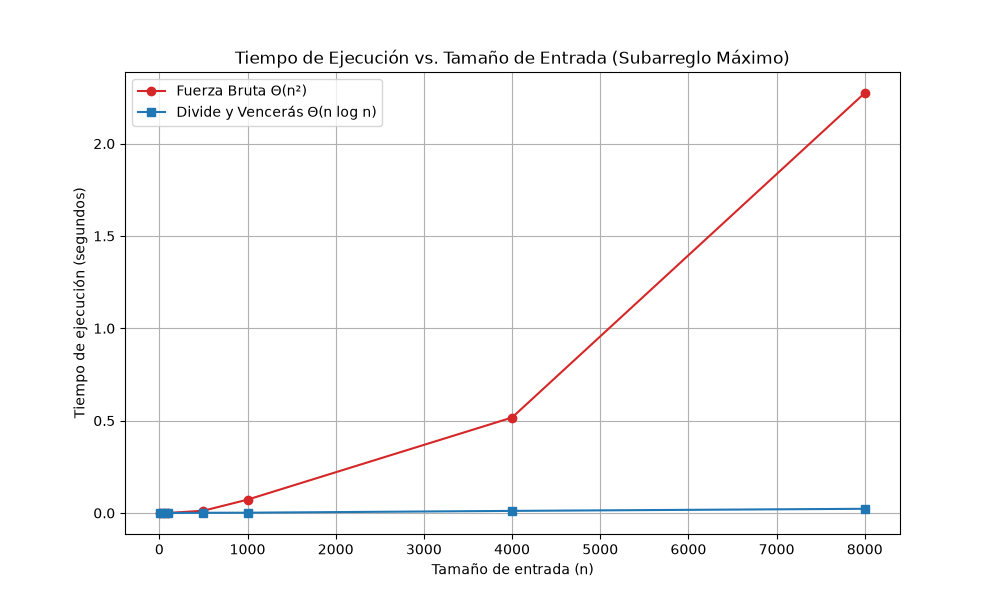

# Laboratorio evaluativo 02 — Dividir y Vencer:  Cooperativa de Tiendas de Barrio

**Estudiante:** Laura Posada Taborda  
**Repositorio:** `lab2-divide-y-vencer`

## Instrucciones para reproducir el experimento

Activar el entorno virtual, instalar dependencias y ejecutar las pruebas o mediciones:

### 1. Activar el entorno virtual e instalar dependencias
```bash
# Ubicarse en la carpeta del laboratorio
cd lab2-divide-y-vencer

# Activar el entorno virtual ubicado en la raíz del repositorio
source /venv/Scripts/activate

# Instalar Matplotlib si no está presente
pip install matplotlib
```

### 2. Ejecutar pruebas y mediciones
```bash

#Ejecutar script de pruebas unitarias y de verificación (pruebas.py)
python pruebas.py

#Ejecutar el experimento de medición de tiempos y generar la gráfica (medicion.py)
python medicion.py
```


## Parte 1 — Implementación y Verificación

[Código de Subarreglo](subarreglo.py) | [Script de Pruebas](pruebas.py)

Las soluciones fueron verificadas mediante scripts de assert que comprobaron el buen funcionamiento en los siguientes casos:

1. Serie de ocho días de la situación problema (resultado esperado: suma de $+17$).Serie de un solo elemento, validando el caso base estricto de la recursión.
2. Serie con todos los valores negativos, asegurando que el algoritmo seleccione correctamente el valor menos negativo.
3. Serie con todos los valores positivos, comprobando la acumulación total del tramo completo.
4. Caso con tramo cruzado forzado, verificando la correcta integración de la función suma_cruzada.
5. Veinte listas aleatorias de tamaños variados, contrastando en cada iteración que los resultados de la fuerza bruta y de divide y vencerás coinciden exactamente con una tolerancia menor a $10^{-5}$.

## Parte 2 — Medición y Gráfica

[Script de Medición](medicion.py)



 Los tiempos de ejecución se midieron utilizando time.perf_counter(), cronometrando solo la llamada a cada función de ordenamiento sin incluir la generación previa de las listas aleatorias.

## Parte 3 — Análisis Teórico y Práctico

1. Recurrencia

El algoritmo de divide y vencerás divide el arreglo de tamaño $n$ en dos mitades independientes de tamaño $n/2$ ($a = 2, b = 2$). El costo de combinar consiste en resolver el caso cruzado usando un barrido lineal que recorre  los elementos desde el punto medio hacia ambos extremos, tomando un tiempo lineal $f(n) = \Theta(n)$. Su recurrencia se plantea como:

$$T(n) = 2T(n/2) + \Theta(n)$$

Aplicando el Método Maestro, tenemos que $a = 2, b = 2$, por lo que $n^{\log_b a} = n^{\log_2 2} = n^1 = n$. Como el costo de combinación es $f(n) = \Theta(n)$, cumple exactamente el Caso 2 ($f(n) = \Theta(n^{\log_b a})$), resolviéndose en:

$$T(n) = \Theta(n \log n)$$

Mientras que, la fuerza bruta implementada evalúa todos los pares posibles $(i, j)$ acumulando la suma de manera iterativa, lo que genera dos ciclos anidados cuyo número total de operaciones crece proporcional a $\sum_{i=1}^{n} (n - i + 1)$, resultando en una complejidad asintótica de $\Theta(n^2)$

2. Lo medido contra lo esperado

En este caso, a medida que el tamaño de entrada $n$ crece, la curva de fuerza bruta ($\Theta(n^2)$, color rojo) experimenta un crecimiento exponencial vertical pronunciado, volviéndose limitativa en tamaños grandes. Por otro lado, la curva de divide y vencerás ($\Theta(n \log n)$, en azul) se mantiene casi horizontal y cercana al eje $X$.

Tomando dos tamaños consecutivos en los que $n$ se duplica a partir de nuestras mediciones ($n = 4000$ y $n = 8000$):

- Fuerza Bruta: En $n = 4000$ tardó $0,516961$ s y en $n = 8000$ tardó $2,274106$ s. El tiempo se multiplicó por un factor de $\frac{2,274106}{0,516961} \approx 4,40$, lo cual coincide cercanamente con el factor $4$ ($2^2$) predicho por el crecimiento cuadrático $\Theta(n^2)$.

- Divide y Vencerás: En $n = 4000$ tardó $0,011414$ s y en $n = 8000$ tardó $0,022797$ s. El tiempo se multiplicó por un factor de $\frac{0,022797}{0,011414} \approx 1,998 \approx 2$, reflejando un comportamiento eficiente lineal-logarítmico $\Theta(n \log n)$.

3. Tamaños pequeños

En los tamaños de entrada pequeños ($n \le 100$), las curvas de ambos algoritmos se sobreponen casi en cero. Analizándolo, a partir de $n = 100$ (Fuerza Bruta: $0,000337$ s vs. Divide y Vencerás: $0,000171$ s), divide y vencerás empieza a ganar ventaja de manera temprana en nuestro rango de prueba. Acá la  diferencia inicial es por la sobrecarga mínima por llamadas recursivas, la cual queda rápidamente tapada cuando $n$ supera los cientos de elementos.

4. ¿Cuándo conviene dividir?

Al comparar con el problema de hallar el máximo de un arreglo, dividir a la mitad no aporta ninguna mejora. Hallar el máximo de forma iterativa directa toma $\Theta(n)$. Si se aplica divide y vencerás, la recurrencia resultante es $T(n) = 2T(n/2) + \Theta(1)$ porque combinar solo requiere comparar dos valores obtenidos de las mitades, un costo constante $\Theta(1)$. Aplicando el Método Maestro, esta recurrencia se resuelve en $\Theta(n)$. Esto quiere decir que divide y vencerás entrega exactamente la misma complejidad lineal $\Theta(n)$ que el recorrido directo, pero cargando con el overhead innecesario de la recursión y la creación de marcos en la pila. La técnica solo conviene cuando el costo de combinar ($f(n)$) es tan grande como para que la reducción en los subproblemas compense ese esfuerzo adicional de combinación.

5. Concepto para la gerente

Se recomienda a la gerente financiera usar el algoritmo de Divide y Vencerás ($\Theta(n \log n)$) para procesar las rachas de las 1.500 tiendas de la cooperativa.Para una serie masiva de $1.000.000$ de registros, se estima el desempeño extrapolando a partir de las mediciones: de acuerdo al tiempo medido de Fuerza Bruta en $n = 8000$ ($2,27$ s), la extrapolación cuadrática arroja un tiempo estimado de más de $35$ horas de procesamiento exclusivo por tienda, lo que hace que no sea viable el análisis nocturno. En cambio, extrapolando con la cota $\Theta(n \log n)$ a partir del tiempo de divide y vencerás en $n = 8000$ ($0,0228$ s), la ejecución para el millón de registros finalizaría en aproximadamente $4,5$ segundos por tienda.Este valor es una estimación matemática basada en las cotas asintóticas.


