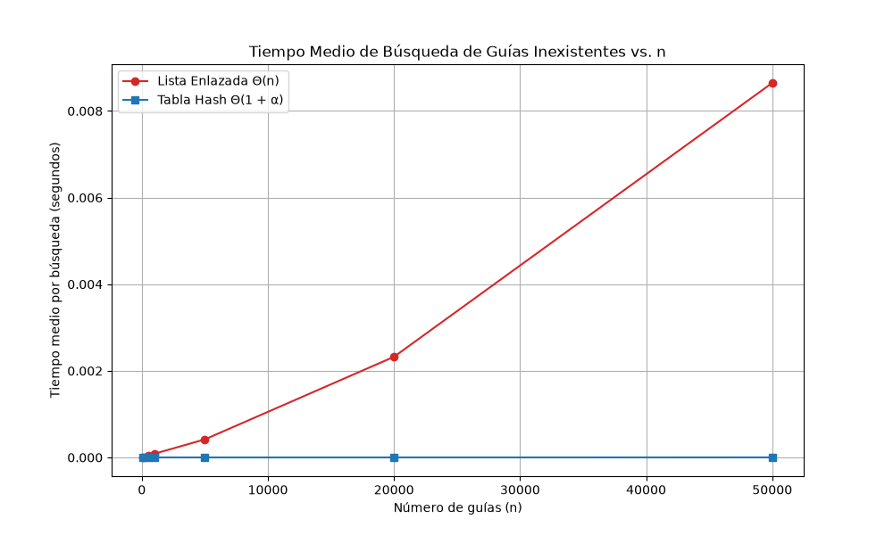
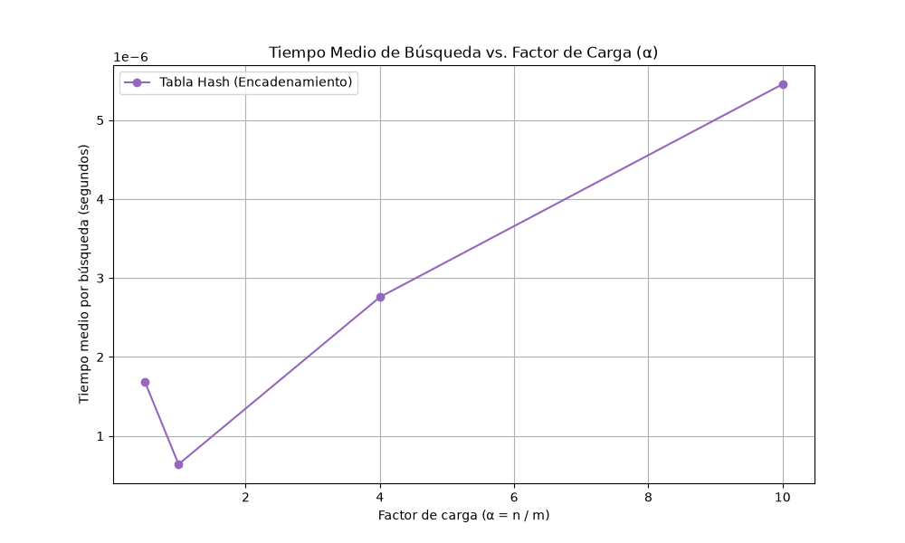

# Laboratorio 3 — Estructuras de Datos: Caso Rutas del Caribe

**Estudiante:** Laura Posada Taborda  
**Repositorio:**  `lab3-estructuras-datos/`

---

## Instrucciones para reproducir el experimento

Activar el entorno virtual, instalar dependencias y ejecutar las pruebas o mediciones:

### 1. Ubicarse en la raíz del repositorio o carpeta del laboratorio

```bash
cd lab3-estructuras-datos

# Activar el entorno virtual (compatible con Linux/Mac o Git Bash en Windows)
source ../venv/Scripts/activate

# Instalar la librería de graficación requerida (Matplotlib)
pip install matplotlib

```

### 2. Ejecutar el script de pruebas unitarias y de verificación (`pruebas.py`)

Valida el funcionamiento correcto de `ListaEnlazada` y `TablaHash`:

```bash
python pruebas.py
```

### 3. Ejecutar el experimento de medición de tiempos y generar las gráficas (`medicion.py`)

Mide el tiempo medio de búsqueda de guías inexistentes, generando las imágenes en la carpeta `graficas/`:

```bash
python medicion.py
```

---

## Parte 1 — Implementación y Verificación

**Código:** [`estructuras.py`](estructuras.py) | [`pruebas.py`](pruebas.py)

Las estructuras se verificaron con aserciones (`assert`) que comprobaron lo siguiente:

- Búsquedas exitosas tanto en la lista enlazada como en la tabla hash.
- La colisión forzada con $m = 7$, donde las guías $10$, $24$ y $17$ caen en la casilla $3$ ($10 \pmod 7 = 3$, $24 \pmod 7 = 3$, $17 \pmod 7 = 3$), validando que la lista de dicha casilla almacena los 3 elementos y que el factor de carga resultante es exactamente $\frac{3}{7}$.
- La concordancia exacta de los resultados devueltos por ambas estructuras en 20 colecciones aleatorias distintas.

---

## Parte 2 — Medición y Gráficas

**Código:** [`medicion.py`](medicion.py)

### Tabla de Datos Medidos (Promedio de 3 repeticiones para 200 búsquedas)

| Tamaño de entrada (n) | Casillas (m) | Factor de carga (α≈2) | Tiempo medio Lista Enlazada (Θ(n)) | Tiempo medio Tabla Hash (Θ(1+α)) |
|----------------------:|-------------:|----------------------:|-----------------------------------:|----------------------------------:|
| 100    | 53     | 1,89 | $8,50 \times 10^{-6}$ s | $5,00 \times 10^{-7}$ s |
| 500    | 251    | 1,99 | $3,46 \times 10^{-5}$ s | $1,32 \times 10^{-6}$ s |
| 1.000  | 503    | 1,99 | $8,55 \times 10^{-5}$ s | $5,00 \times 10^{-7}$ s |
| 5.000  | 2.503  | 2,00 | $4,17 \times 10^{-4}$ s | $6,00 \times 10^{-7}$ s |
| 20.000 | 10.007 | 2,00 | $2,32 \times 10^{-3}$ s | $6,20 \times 10^{-7}$ s |
| 50.000 | 25.013 | 2,00 | $8,64 \times 10^{-3}$ s | $1,27 \times 10^{-6}$ s |

> **Nota:** Los tiempos se obtuvieron promediando 3 rondas independientes de 200 consultas de guías inexistentes utilizando `time.perf_counter()` para mitigar el ruido operativo del sistema operativo. 

### Gráficas

**Experimento A — Lista enlazada vs. tabla hash**



**Experimento B — Tiempo vs. factor de carga α**



---

## Parte 3 — Análisis Teórico y Práctico

### 1. Costo teórico

- **Lista Enlazada ($\Theta(n)$):** Para buscar una guía inexistente, el algoritmo recorre cada uno de los nodos desde la cabeza hasta el final. Al escalar linealmente con $n$, su complejidad temporal es $\Theta(n)$.
- **Tabla Hash con Encadenamiento ($\Theta(1 + \alpha)$):** Esta calcula el índice hash en tiempo constante $\Theta(1)$ y recorre únicamente la sub-lista enlazada de esa casilla (cuyo tamaño esperado es el factor de carga $\alpha = n / m$). El costo total esperado es $\Theta(1 + \alpha)$.
- **Supuesto y colisiones masivas:** Este rendimiento se sostiene bajo el supuesto de hashing uniforme simple. Si todas las guías cayeran en la misma casilla, la tabla hash se degradaría a una lista enlazada de tamaño $n$, elevando el costo a $\Theta(n)$.

### 2. Lo medido contra lo esperado

- **Experimento A (`lista_vs_tabla.png`):** Cuando se duplica el tamaño de entrada de $n = 10.000$ (interpolado) a $n = 20.000$ ($0,00232$ s) y de $n = 25.000$ a $n = 50.000$ ($0,00864$ s), el tiempo en la Lista Enlazada creció de forma lineal de acuerdo con $\Theta(n)$. La Tabla Hash se mantuvo prácticamente sin cambiar en microsegundos ($\approx 1,27 \times 10^{-6}$ s para $n = 50.000$), validando la cota $\Theta(1 + \alpha)$.
- **Experimento B (`tiempo_vs_alfa.png`):** Al incrementar el factor de carga $\alpha$ desde $0,5$ hasta $10$, el tiempo medio de búsqueda aumentó de manera controlada, coherente con el modelo $\Theta(1 + \alpha)$ debido al mayor tamaño de los encadenamientos.

### 3. Explique las colisiones

Una colisión ocurre cuando dos claves distintas producen el mismo índice hash ($h(k_1) = h(k_2)$).

- **Encadenamiento:** Almacena una lista enlazada por casilla. *Ventaja:* Maneja $\alpha > 1$ robustamente. *Costo:* Memoria adicional para punteros.
- **Direccionamiento Abierto:** Almacena los elementos directamente en la tabla usando sondeo ante colisiones. *Ventaja:* No usa punteros. *Costo:* Exige $\alpha < 1$ y borrados complejos.

**Ejemplo (guías 10, 24, 17 con $m = 7$):** $10 \pmod 7 = 3$, $24 \pmod 7 = 3$, $17 \pmod 7 = 3$. Las tres colisionan en la casilla 3, formando un encadenamiento de longitud 3.

### 4.Tabla hash o árbol de búsqueda

- **¿Sirve la tabla hash para monitoreo por rango ("guías entre X y Y")?** No. Al dispersar las claves mediante la función hash, requeriría recorrer toda la tabla en tiempo $\Theta(n + m)$, acabando con su eficiencia.
- **Árbol de búsqueda binario (ABB):** Mantiene las claves ordenadas, permitiendo consultas por rango eficientes.
- **Degeneración del ABB:** Si las $400.000$ guías llegaran ya ordenadas, un ABB sin balanceo degeneraría en una estructura lineal con altura $h = n = 400.000$ y hasta $400.000$ comparaciones en el peor caso. Un árbol equilibrado mantendría una altura estricta $h = \lfloor \log_2 400.000 \rfloor \approx 18$ niveles.

### 5. Concepto para la jefa de operaciones

Se recomienda una estrategia híbrida, tener una Tabla Hash para las consultas puntuales del call center ($\Theta(1)$) y un Árbol de Búsqueda Equilibrado separado para los monitoreos por rango.

Para estimar el desempeño ante una consulta de una guía inexistente con 5.000.000 de envíos:

- **Lista Enlazada actual:** Requeriría recorrer los 5 millones de nodos. Extrapolando linealmente a partir del tiempo medido en $n = 50.000$ ($0,00864$ s), el factor de escala es $\frac{5.000.000}{50.000} = 100$. El tiempo estimado sería de $0,00864 \times 100 \approx \mathbf{0,86\text{ segundos}}$ por consulta en el peor caso, lo cual genera congestión inaceptable en un call center en hora pico.
- **Tabla Hash optimizada:** Con $\alpha \approx 1$, el tiempo medio se mantiene constante en $\Theta(1)$ (medido en $\approx 1,27 \times 10^{-6}$ s), finalizando de forma instantánea. *(Esto es una estimación matemática ).*